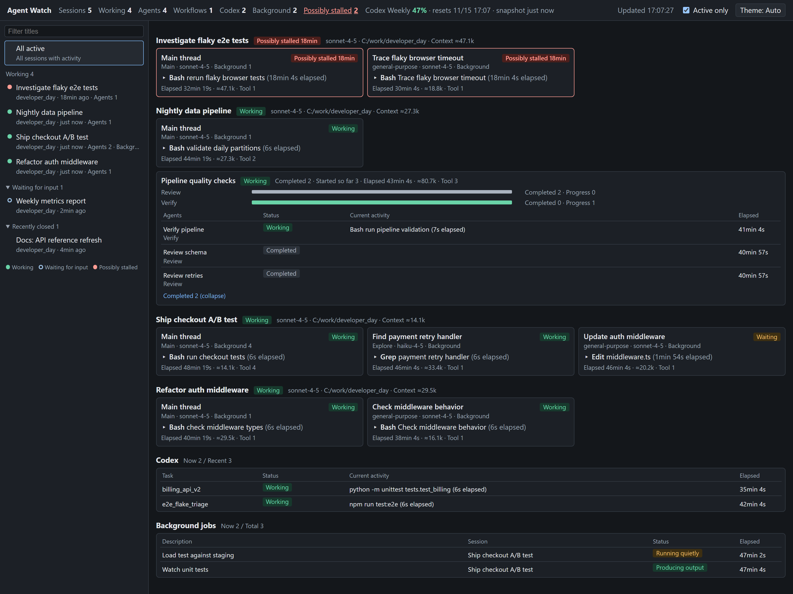

# Agent Watch

When many agents run in parallel, it is hard to see which are working, waiting for input, or stuck. Agent Watch is a read-only local dashboard for Claude Code sessions, subagents, workflows, background shell jobs, and Codex runs. It shows current tools, short masked arguments, recent messages, and elapsed time in one browser page, using Python's standard library and a single HTML file.



*Screenshot: synthetic demo data generated by `tools/demo_data.py`, plus sample session registry entries so sessions show as live.*

## Features

| Panel | What it shows |
|---|---|
| Top bar | Live sessions and active agents, workflows, Codex runs, and background jobs; clickable stalled counts; Codex weekly usage, reset time, and snapshot age |
| Sidebar | Working sessions, waiting-for-input sessions, and recently closed sessions, with a title filter |
| Sessions | Main-thread and subagent cards, workflow phases, status, current activity, and elapsed time |
| Codex | Task (working folder name), status, current command, and elapsed time; click for model, sandbox, tokens, and turns |
| Background jobs | Description, session and owner, status, and elapsed time; hover for ID and output size |
| Detail drawer | Recent events, current activity, last message, and elapsed time; tool calls and results share one row, newest first |

Tool output and file contents are not displayed. A disconnect banner pauses elapsed clocks until the server reconnects. The page supports light, dark, and automatic themes.

## Quick start

On Windows, install Python and make it available on PATH. Run `start_agent_watch.cmd` to open the server and `http://127.0.0.1:8810/`. The launcher uses `py -3` when available, otherwise `python`.

To run directly from this folder:

```powershell
py -3 -X utf8 -B server.py --port 8810
```

Run `stop_agent_watch.cmd` to request graceful shutdown. It creates `state/agent_watch.stop`; the server consumes and renames it, usually within a second. This does not terminate processes by name. For a custom state directory, create `agent_watch.stop` in that directory instead.

| Option | Default | Meaning |
|---|---|---|
| `--port` | `8810` | HTTP port; `0` selects an available port recorded in `state/run.json` |
| `--host` | `127.0.0.1` | Bind address; non-loopback addresses require `--allow-lan` |
| `--allow-lan` | Off | Explicitly permit non-loopback binding; there is no authentication |
| `--window-hours` | `24` | Recent-session window, minimum 0.1 hours |
| `--interval` | `2` | Tick interval in seconds, minimum 0.5 |
| `--state-dir` | `state/` beside the server | Run metadata, stop requests, and diagnostic logs |
| `--claude-home` | `~/.claude` | Claude data root |
| `--codex-home` | `~/.codex` | Codex data root |
| `--temp-claude` | `%TEMP%/claude` | Background task inventory root; falls back to `%TMP%`, then the user's local temporary directory |
| `--title-denylist-file PATH` | None | UTF-8 file containing one private-title term per line; `#` starts a comment |

For optional autostart, keep `AgentWatch_8810.vbs` beside `server.py` and put a **shortcut** to the helper in the Startup folder (`Win+R`, then `shell:startup`). It waits 30 seconds and launches silently. It resolves the server relative to its own file and uses `pythonw.exe` from PATH. If needed, edit `PYTHON_EXE` in the helper to the full path of your Python windowless executable. Copying only the helper to Startup would break its relative server path.

## Try it with demo data

From this folder, generate a synthetic developer day and start the dashboard:

```powershell
python -B tools/demo_data.py demo-data
python -B server.py --claude-home demo-data/claude --codex-home demo-data/codex --temp-claude demo-data/temp --state-dir demo-data/state --port 8815
```

Open `http://127.0.0.1:8815/`. The generator also prints the server command with absolute paths (PowerShell on Windows). Use a new or empty output directory whose parent already exists; existing data is never overwritten. No real agent data is read. The scene includes six sessions, five subagents, a Review/Verify workflow, three background jobs, and three Codex runs with 47% weekly usage. Turn off **Active only** to include completed work.

These are static, headless transcripts: process liveness is unknown, so the top-bar live-session counters stay at zero. The stalled session may be grouped with closed sessions in the sidebar because its activity is older than ten minutes. Select it to inspect its stalled status. Timestamps are relative to generation time; open the demo promptly, and generate into a fresh directory to reset aging activity.

## How it works

The scanner reads Claude session registry JSON, project transcripts, subagent metadata and transcripts, workflow journals and terminal records, and Codex rollout JSONL under their configured roots. It inventories background `.output` files by name, size, and modification time without opening their contents. Windows process creation times help distinguish live sessions from reused PIDs; process command lines are not read.

Incremental readers start with file tails, then recover launch records and counts through bounded backfill. Replacement detection resets state when a file changes generation. Readers close handles between ticks and use sharing flags so writers and atomic replacements can continue. Very short contention during replacement is still possible.

Source trees are read-only. Transcript contents and dashboard snapshots stay in memory and are not persisted. The server writes only run metadata, consumed stop requests, and diagnostic logs in its own state directory. Logs contain error signatures rather than transcript text. Browser local storage retains display preferences only.

### Status and counts

Claude activity within 60 seconds is working; longer quiet periods become waiting when a reason is known. A possible stall normally means 12 minutes without a response, accounting for tool timeouts capped at ten minutes plus two minutes of grace. Human-input tools do not trigger stall timers. Synchronous child activity contributes to the parent's status. Completion can be inferred from transcript endings, and later activity can reopen an agent.

Codex uses record timestamps and observed file growth, not file mtime: 60 seconds for active work, 15 minutes for possible stalls, and six hours for missing completion records. Dormant runs are checked every 30 seconds and wake when they grow. Workflow status follows its agents, including their pending background work.

Background jobs have no stall timer. Missing output files, jobs from earlier session processes, expired Monitors, or closed owners can imply completion. Quiet persistent Monitors stop blocking owner completion after one hour. Completion notifications remain in job records even when notification indexes reach their limits.

`≈` marks an estimate of the last assistant message's context: input, cache creation, cache reads, and output. It is not cumulative usage. Values without `≈` come from completion records. Estimates and workflow totals may decrease on completion because the records use different output snapshots. Tool counts use unique IDs and become approximate beyond 20,000 IDs per file. Counts may differ from Claude Code's built-in agent map.

## Privacy and security model

The default is loopback-only access. Non-loopback binding is refused unless explicitly enabled. Host, Origin, and Sec-Fetch-Site checks restrict browser requests; nonce-based Content Security Policy, no-store caching, no-referrer, frame protection, and MIME-sniffing protection apply to responses. These controls do not provide authentication for LAN exposure.

Free-text display fields are masked on the server before truncation. IDs must pass format validation. Masking covers known credential prefixes, secret assignments, quoted and multiline values, encoded keys, folded headers, YAML block values, shell continuations, and adjacent string concatenation. **Secret labels are recognized in English and Korean.** Key decoding supports up to three percent-encoding layers, character escapes, HTML entities, compatibility normalization, and zero-width-character removal; ordinary text is preserved when no credential value follows.

Windows user-home prefixes become `~`. UNC paths such as `\\files.example\shared\work\report.txt` and `//files.example/shared/work/report.txt` display as `UNC:/work/report.txt`, hiding the host and share. This is display masking, not a change to source paths.

### Configurable title denylist

The default denylist is empty. Set comma-separated terms in `AGENT_WATCH_TITLE_DENYLIST` and/or supply a file. Both sources are combined at startup; blank terms and comment-only lines are ignored. Restart after changing configuration.

```powershell
$env:AGENT_WATCH_TITLE_DENYLIST = 'client-x, salary, legal'
py -3 -X utf8 -B server.py --title-denylist-file private-titles.txt
```

Example `private-titles.txt`:

```text
# Private project names
client-x
salary
legal # Inline comments are supported
```

Matching is case-insensitive substring matching, so a term also matches inside a longer word. A session title or path hit hides the entire session, including its folder name. Either the latest custom title or latest automatic title can trigger privacy. Agent description or phase hits hide that agent and its owned background descriptions. A Codex task-folder or path hit hides the run. Unknown workflow names and missing background owners remain private until enough information is available. Detail APIs use the same immutable privacy snapshot as the page.

The dashboard never displays raw tool results, output-file bodies, Write/Edit contents, prompts, thinking, workflow scripts/results/logs, notification result bodies, Codex stdout/stderr, credentials files, or process command lines. Bash without a description shows only its executable name. Unknown tools show only their names.

## Assumptions

| Assumption | Consequence or fallback |
|---|---|
| Registry `waiting` means permission/response waiting; `shell` means shell execution | These interpretations are labeled inferred |
| Headless sessions may have no registry entry | Liveness is unknown for up to one hour after activity, then the session appears closed |
| An agent with pending background work is not finished merely because it emitted `end_turn` | Display Waiting for background jobs |
| Background work ends with its owning agent | Display Ended with agent (inferred) |
| Codex rollout folders use local dates | Scan three days of folders to absorb date boundaries |
| Codex abort/error event formats may vary | `turn_aborted` closes the turn as Finished (other); other abort/error names are only candidate signals |
| A numeric `session_id` in command output means the command still runs | Without it, close the command; a Script running marker waits for subsequent wait output |
| Background jobs predating session process startup belong to an earlier process | Keep them active if output is still arriving |
| Windows may delay mtime updates until a write handle closes | Compare the last 256 bytes when only mtime changes; same-size overwrites with identical trailing bytes remain undetected |
| Codex and Claude session linkage | Not implemented |
| Token completion counts follow the Claude Code 2.1.301 definition | Mark context estimates with ≈ |

## Known limitations

- Thinking contents are unavailable in the source records; activity comes from tool calls and messages. Current activity appears only after upstream writes it, plus scanner latency.
- Upstream file formats are not a stable API. This is a Windows-oriented local utility, not a process supervisor.
- With no observer for 60 seconds, ticks slow to 15 seconds. Returning to the page wakes the scanner. Heavy ticks can also trigger backoff.
- Background liveness is inferred from records and output metadata; no background process command lines are inspected. Running quietly means no completion has been found.
- Large rollouts initially have inexact turn counts; gaps are counted at up to 2MB per tick. Other backfill can also delay accurate initial status and counts.
- Responses are capped at 1MB. Finished items are removed first, then per-section caps shrink, then low-priority sessions are omitted. Counts retain totals and omission labels explain the difference. Omitted items cannot be opened through detail APIs.
- Above 200 hot files, each tick reads 150 recent files plus 50 least-recently-read files. A set of N files is covered within ceil((N-150)/50) ticks; 1,000 files can take about 34 seconds at two-second ticks or 4 minutes 15 seconds unobserved. `/healthz` reports actual lag.
- Open background outputs are checked 64 per session per tick, at most eight ticks for the 500-job cap. Placeholders waiting for launch records can be evicted at that cap; a later launch may then appear open. Open workflow launch records are capped at 4,096; lost names stay private. Above 2,048 retired-agent tombstones, old metadata may be reread.
- HTTP handling is limited to 16 simultaneous requests with a 30-second whole-request deadline. Excess connections receive 503 when possible after at most 100ms waiting for request bytes; split or late requests may see a disconnect instead.
- Titles outside the head and tail windows affect privacy only after backfill. Closed sessions do not backfill, so titles beyond their head/tail windows may never be found. Configure terms with this limitation in mind.
- Masking is heuristic. Remaining gaps include four or more percent-encoding layers, cross-alphabet lookalikes, encoded quotes only in values, prefixed string literals, multiline concatenation, PowerShell SecureString expressions, suffixed flags, assignment-free shell commands, numeric user/password pairs indistinguishable from uid:gid, non-leading or tagged YAML block keys, split bare values, encoded separators, and proxy-user flags. Some nonsecrets resembling credentials or folded values are also hidden. Short hex, single-case blobs, Base32, and some unlabeled secrets may remain visible.
- Completed cards can retain pending-background counts; ordinary Monitor events may appear twice in details. Codex weekly usage is a snapshot refreshed only by Codex activity.

## Troubleshooting

| Symptom | Action |
|---|---|
| Exit code 2 | Check arguments, UTF-8 denylist file access, and non-loopback binding flags |
| Exit code 3 | An instance already holds the port; reuse it or request shutdown |
| Exit code 4 | Binding failed; inspect `netstat -ano` and choose another port |
| Disconnected banner | Restart the server; the page reconnects and refreshes its snapshot |
| Intermittent 503 | Concurrent connection limit reached; retry after a moment |
| Reading launch records persists | Allow backfill to finish; large histories take longer |
| Launcher cannot find Python | Check `py -3` or `python` on PATH; configure the optional VBS helper separately |
| Need diagnostic details | Inspect `state/agent_watch.log`; it rotates at 1MB to `.log.old` |

## Running tests

Run from the repository folder:

```powershell
python -X utf8 -B -m unittest discover -s tests
```

The suite uses synthetic fixtures and retains generated files under `tests/_scratch/`. It exercises parsers, collectors, masking, HTTP protections, retention caps, and source immutability. `tests/smoke_live.py` reads your real local data and is **opt-in**, not part of unittest discovery. `tests/leak_scan.py` is also a manual live-data utility. Neither is needed for the synthetic suite.

## Tested environment

Windows 11; Python 3.14; Claude Code 2.1.30x; Codex CLI 0.153. Other versions may change the file formats the dashboard reads.

## License

MIT License. Copyright (c) 2026 Hyunseok Jin. See [LICENSE](LICENSE).
